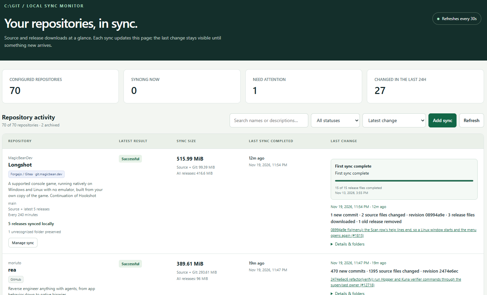

# offline-git-sync

Keep local copies of public Git repositories and their release downloads, with a Windows dashboard for managing what stays on your PC.

**Use at your own peril.** This is a personal utility shared as-is, with no warranty or promise of support. It could set your PC on fire, reveal the secrets of life, or—more plausibly—fill your disk and delete old release downloads exactly as configured. Keep backups, read the cleanup previews, and don't make this your only copy of anything important. The fire and enlightenment claims are jokes; the file deletion is real.



The screenshot shows an existing installation. A fresh installation starts empty; no repositories, personal configuration, logs, or downloaded applications are included.

## What it does

- Keeps a local source checkout and Git history for public GitHub repositories and compatible public Forgejo/Gitea hosts.
- Downloads assets matching your filename patterns from the latest selected releases, plus a source ZIP for each retained release.
- Runs scheduled syncs through Windows Task Scheduler, independently of the browser and Codex.
- Adds and manages syncs from a local dashboard: schedules, release limits, asset patterns, and first-sync progress.
- Previews which assets match **all your patterns together**, without downloading them.
- Shows actual local release counts and total **Sync Size**, including source, Git history, and all local releases; sorts by size.
- Previews cleanup of old releases or assets that no longer match your saved patterns.
- Archives a sync by removing its scheduled task while preserving its files and dashboard entry. Archived entries can still be cleaned up or resumed.

“Offline” means the downloaded copies stay on your computer and can be used without the host. **Syncing and remote Asset Preview need an Internet connection.** This tool downloads files; it does not install, run, or update the applications inside those downloads. It never commits or pushes your changes upstream.

## Requirements

| Component | Requirement and download |
| --- | --- |
| Windows | Windows 11 x64 is the tested platform. Windows Task Scheduler must be available; the setup examples use PowerShell. Linux and macOS are not supported; Windows 10 and ARM64 have not been validated. |
| Python | **Python 3.11 or newer**, with `pip` and `pythonw.exe`. Install a normal Windows Python distribution from [python.org](https://www.python.org/downloads/windows/), not the embeddable ZIP. Python 3.11.4 is the observed working baseline; newer versions have not all been tested. |
| Git | Install a current stable [Git for Windows](https://git-scm.com/install/windows/) and make `git` available on `PATH`. The working installation used `2.55.0.windows.5`; this is a tested baseline, not a proven lowest compatible version. GitHub Desktop alone is not the documented setup. |
| Python dependency | [Truststore](https://truststore.readthedocs.io/en/latest/) **0.10.5**, installed locally by the setup command below. It provides Windows certificate validation for Python HTTPS requests. |
| Git LFS | Install a current stable [Git LFS](https://git-lfs.com/) if your repositories use it. Without it, LFS files may remain small pointer files and the dashboard shows a warning. Ordinary source and release downloads can continue. |
| Browser and storage | A current browser, a stable folder you can write to, and enough free space for source history, LFS objects, and retained releases. There is no fixed disk requirement. |

No Node.js, Docker, Hyper-V, AI service, paid account, or Codex installation is needed to run the app. Use the same Windows account to create and manage its scheduled tasks. Your Windows policy must allow that account to create tasks and run Python.

## Install and open

1. Install Python and Git using the links above. Open a new PowerShell window and check that `python --version` and `git --version` work.
2. Download this repository with **Code → Download ZIP** and extract the entire folder to a permanent writable location. A short path such as `C:\OfflineGitSync` helps with long repository filenames. Choose a folder under your user account if you cannot write there. You can also clone it:

   ```powershell
   git clone https://github.com/klownicle/offline-git-sync.git C:\OfflineGitSync
   ```

3. In PowerShell, enter the folder and run setup:

   ```powershell
   Set-Location C:\OfflineGitSync
   python .\install.py
   ```

   Setup checks the prerequisites, installs the pinned Python dependency into `.tools\python`, creates an empty configuration if one does not exist, and creates **Open dashboard.vbs** using the Python interpreter you selected. It does not add a repository or start a sync.

4. Double-click **Open dashboard.vbs**. If Windows Script Host/VBScript is unavailable, open the same dashboard from PowerShell:

   ```powershell
   python .\github_sync.py dashboard --open
   ```

Keep all `github_*.py` files together. The installation folder also holds your downloaded repositories, releases, configuration, and status. Keep that folder and the selected Python installation in place after creating schedules; scheduled tasks store absolute paths.

## Add your first sync

1. Click **Add sync**.
2. Enter a GitHub `owner/repository`, a GitHub HTTPS repository URL, or the full HTTPS URL of a compatible Forgejo/Gitea repository. A bare `owner/repository` always means GitHub.
3. Choose an interval from **5–1440 minutes**, an optional local start time, and **1–100** recent releases. `1440` means daily. A blank branch uses the default branch on the first checkout; **Source only** skips release downloads.
4. Add asset patterns such as `*windows*x64*.zip`, `*.exe`, or `*.apk`. Patterns match case-insensitively; a file matching **any** pattern is included. `*` selects every asset. Source ZIPs are included independently of these patterns when release syncing is enabled.
5. Open **Asset Preview** to see the combined selection, and adjust patterns before saving.
6. Leave **Run first sync now** checked to start immediately and watch its progress, or uncheck it to wait for the schedule.

The default selection is the latest five releases, every 15 minutes, with `*windows*x64*.zip`. Published prereleases count toward the release limit. Choose a less frequent schedule for large collections or hosts with strict API limits.

## Manage downloaded data

| Dashboard control | What happens |
| --- | --- |
| **Manage sync** | Change the interval, optional start time, and release limit. Saving does not itself run a sync. |
| **Asset patterns** | Add, edit, or remove filename patterns. Save them to affect future downloads; changing a pattern does not delete existing files. |
| **Asset Preview** | Fetch release metadata on demand and highlight matching assets. It does not download them or change the schedule. |
| **Cleanup** | Preview and then delete a chosen number of the oldest recognized local release folders, including their assets and source ZIPs. |
| **Refresh Assets** | Preview the number, size, and examples of recognized downloaded assets that no longer match saved patterns, then confirm deletion. It does **not** download missing matches. Source ZIPs, source checkouts, metadata, and unrecognized files are preserved. |
| **Archive / Resume** | Archive removes the scheduled task and stops sync runs but keeps all files and the dashboard entry. Resume recreates the schedule without immediately syncing. |
| **Remove** | Remove the dashboard entry and its scheduled task. Local source, releases, and status history remain on disk. |
| **Refresh** | Refresh local dashboard status; this is not a “sync all now” button. |

**Automatic retention deletes older recognized release folders after the selected releases download successfully.** It is separate from manual cleanup. A later active sync can download manually deleted releases again if they remain in its configured selection. Archive first if you want to stop downloads while keeping or cleaning up the local collection.

## Details and limitations

The [usage guide](docs/usage.md) covers command-line examples, storage layout, schedules, backups, upgrades, uninstalling, and troubleshooting.

- Public **GitHub** and compatible public **Forgejo/Gitea** release APIs are supported. This is not generic support for GitLab, Bitbucket, or every Git server. Private repositories, authentication-token configuration, custom ports, and hosts installed under URL subdirectories are not supported.
- API requests are unauthenticated. GitHub's documented primary limit is [60 requests per hour per originating IP](https://docs.github.com/en/rest/using-the-rest-api/rate-limits-for-the-rest-api); multiple repositories, release pages, and previews share that budget. Being signed into your browser does not authenticate this app's requests.
- Source updates normally fast-forward. Recognized upstream history rewrites can be followed with a backup Git reference. Conflicting local work stops the update; keep development work elsewhere. This is a local mirror utility, not an immutable backup or an application installer.
- Submodules are not recursively initialized. Missing upstream LFS objects cannot be recovered by this tool. A repository with no published releases still syncs source and preserves existing release downloads.
- The management helper listens only on `127.0.0.1` and closes after ten idle minutes. The open dashboard refreshes every 30 seconds and keeps it alive. Do not expose it through a proxy or port forward.

This is a personal, as-is publication. Contributions and support requests are not being accepted; see [CONTRIBUTING.md](CONTRIBUTING.md).

## License

[MIT](LICENSE). You may use and modify this utility under that license, with no warranty. Repositories and release assets downloaded with it retain their own licenses.
